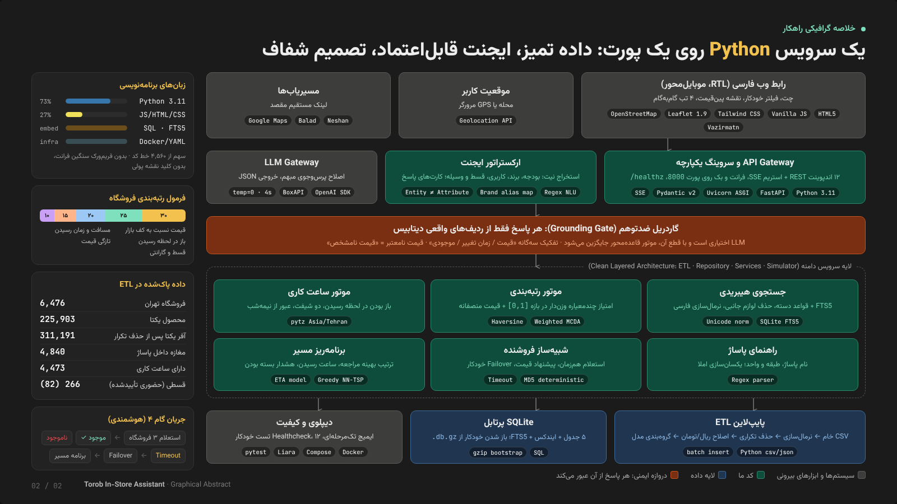
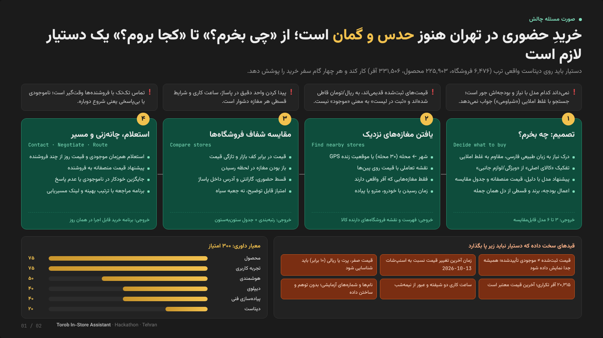
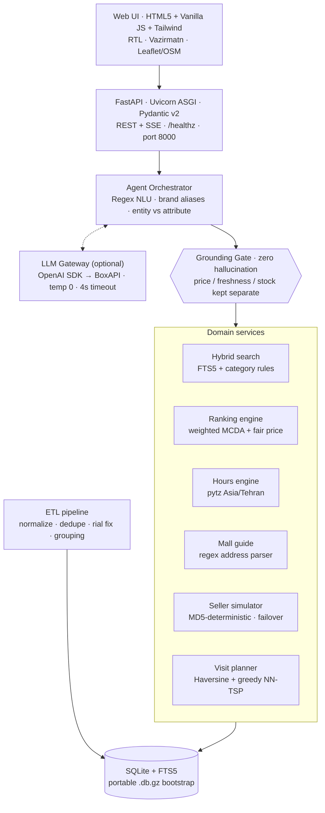

<div align="center">

# 🛍️ دستیار هوشمند خرید حضوری ترب در تهران
### Torob In-Store Shopping Assistant: an agentic AI that takes a Tehran shopper from *“what should I buy?”* to *“which shop, which floor, what time?”*


**۶٬۴۷۶ فروشگاه · ۲۲۵٬۹۰۳ محصول · ۳۱۱٬۱۹۱ آفر یکتا · ۳۰ محله تهران · ۴ گام کامل سفر خرید**

[🎞️ اسلایدهای ارائه (HTML تک‌فایل)](docs/slides.html) · [🎬 سناریوی دمو](docs/DEMO_SCRIPT.md) · [⚖️ راهنمای داوران](docs/JUDGING_CHEAT_SHEET.md)

</div>

---

## 🧭 خلاصه گرافیکی (Graphical Abstract)



> کل راهکار یک سرویس **Python 3.11 / FastAPI** است که فرانت‌اند و بک‌اند را روی یک پورت سرو می‌کند. داده خام ترب در یک پایپ‌لاین ETL پاک و در **SQLite + FTS5** ذخیره می‌شود. یک **ایجنت قاعده‌محور با کمک اختیاری LLM** نیت کاربر را می‌فهمد و هر پاسخ قبل از رسیدن به کاربر از **گاردریل ضدتوهم** عبور می‌کند: هیچ قیمت، فروشگاه یا موجودی‌ای خارج از ردیف‌های واقعی دیتابیس ساخته نمی‌شود.

---

## 🎯 صورت مسئله: نیازهایی که چالش مطرح کرد



خرید حضوری از پاساژهای تهران (علاءالدین، چارسو، پایتخت، لاله‌زار و...) پر از عدم قطعیت است:

| درد خریدار | پاسخ ما |
| :--- | :--- |
| نمی‌داند چه مدلی با نیاز و بودجه‌اش جور است؛ جستجو با «شیاومی» جواب نمی‌دهد | فهم زبان طبیعی فارسی، نگاشت املاهای غلط، تفکیک **کالای اصلی** از **ویژگی/لوازم جانبی** |
| قیمت‌های ثبت‌شده قدیمی، ریالی یا پرت‌اند و «ثبت در لیست» ≠ «موجود» | **تفکیک سه‌گانه** قیمت / زمان تغییر / موجودی، اصلاح ریال→تومان، برچسب `قیمت نامشخص` |
| پیدا کردن طبقه و واحد در پاساژ، ساعت کاری و شرایط قسطی سخت است | پارسر آدرس پاساژ، موتور ساعت کاری به وقت تهران، پارسر دوسطحی اقساط |
| تماس تک‌تک با فروشنده وقت‌گیر است و ناموجودی یعنی شروع دوباره | **استعلام هم‌زمان**، پیشنهاد قیمت منصفانه و **Failover خودکار** |

### چهار گام سفر خرید که پوشش داده شد

1. **تصمیم: چه بخرم؟** پیشنهاد مدل با دلیل، **قیمت منصفانه بازار** و جدول مقایسه مشخصات؛ بودجه، برند و قسط مستقیم از متن کاربر استخراج می‌شود. اگر برند خواسته‌شده در بودجه موجود نباشد، دستیار صادقانه می‌گوید و جایگزین هم‌رده پیشنهاد می‌دهد.
2. **یافتن مغازه‌های نزدیک:** شهر ← محله (۳۰ محله) یا GPS؛ نقشه **Leaflet/OSM** با قیمت روی پین‌ها و Spiral Offset برای مغازه‌های یک پاساژ؛ فقط مغازه‌های دارای آفر واقعی.
3. **مقایسه شفاف فروشگاه‌ها:** امتیاز قابل توضیح در `[0,1]` و جدول ستون‌به‌ستون.
4. **استعلام، چانه‌زنی و مسیر:** موجود / ناموجود / Timeout، جایگزین خودکار، و برنامه مراجعه با ترتیب بهینه و لینک **نشان، بلد و گوگل‌مپ**.

---

## 🏗️ معماری فنی



### تصمیم‌های مهندسی کلیدی

| تصمیم | چرا |
| :--- | :--- |
| **یک سرویس، یک پورت** (FastAPI فرانت را هم سرو می‌کند) | دیپلوی تک‌کانتینری روی لیارا، بدون CORS و بدون سرویس اضافه |
| **SQLite + FTS5 به جای پایگاه‌داده سرور** | داده فقط‌خواندنی است؛ تأخیر زیر میلی‌ثانیه، صفر هزینه زیرساخت، فایل `.db.gz` در بوت باز می‌شود |
| **LLM فقط برای ابهام، نه برای واقعیت** | پرس‌وجوی مبهم را به JSON ساختاریافته تبدیل می‌کند؛ با قطع API موتور قاعده‌محور ادامه می‌دهد و هیچ عددی از LLM نمی‌آید |
| **امتیاز وزن‌دار شفاف به جای مدل جعبه‌سیاه** | هر رتبه قابل توضیح است و داور می‌تواند دلیلش را ببیند |
| **شبیه‌ساز قطعی (MD5 روی `shop_id:product_id`)** | دموی تکرارپذیر: هر بار همان فروشنده همان رفتار را دارد |
| **نقشه بدون کلید پولی** (Leaflet + OSM + deep link) | بدون وابستگی به سرویس تجاری و بدون محدودیت سهمیه |

### فرمول رتبه‌بندی فروشگاه

```text
score = 0.30·price  +  0.25·distance  +  0.20·open_on_arrival  +  0.15·freshness  +  0.10·installment
fair_price = round(0.6·min_group_price + 0.4·median_group_price, 10_000 toman)
```

* **price:** نسبت کف قیمت گروه مدل به قیمت مغازه؛ قیمت‌های پرت (کمتر از `0.45` یا بیشتر از `2.2` برابر) جریمه می‌شوند.
* **distance:** فاصله Haversine تا ۱۸ کیلومتر، با ETA جداگانه برای خودرو، مترو و پیاده.
* **open_on_arrival:** باز بودن در **لحظه رسیدن**، نه لحظه جستجو (با دو شیفت و عبور از نیمه‌شب).
* **freshness:** سطل‌های Fresh / Recent / Old / Stale نسبت به اسنپ‌شات `2026-10-13`.
* **installment:** قسط حضوری تأییدشده `1.0`، اعلام‌شده `0.7`، بدون قسط `0.2`.

---

## 📊 کیفیت داده: قوانین دیتاست ترب

| شاخص | مقدار | نحوه پردازش |
| :--- | :---: | :--- |
| فروشگاه‌های تهران (`shops.csv`) | `6,476` | ۳۰ محله و مرکز ثقل جغرافیایی هر محله |
| فروشگاه‌های دارای نام واقعی | `112` | `22` با اینستاگرام، `90` با وب‌سایت |
| فروشگاه‌های قسطی | `266` | `82` **قسط حضوری تأییدشده** و بقیه **اعلام‌شده** (ترب‌پی، اسنپ‌پی، دیجی‌پی، تارا، ازکی‌وام) |
| دارای برنامه ساعت کاری | `4,473` | `27,270` روز کاری، `4,006` تعطیل، `35` نامشخص؛ دو شیفت و Cross-Midnight |
| داخل پاساژ یا مجتمع | `4,840` | استخراج پاساژ/طبقه/واحد با Regex و یکسان‌سازی املا (علاءالدین / علاالدین / علالدین) |
| محصولات یکتا (`products.csv`) | `225,903` | نرمال‌سازی فارسی/عربی/انگلیسی، `compact_specs` و `product_group_id` |
| آفرها (`offers.csv`) | `331,506` | حذف `20,315` تکراری با آخرین تاریخ تغییر (`311,191` یکتا) و اصلاح قیمت ریالی |

**قانون طلایی:** در هیچ کارت یا جدولی قیمت ثبت‌شده با موجودی ادغام نمی‌شود. همیشه سه بخش مستقل نمایش داده می‌شود:
۱. قیمت ثبت‌شده یا تأییدشده · ۲. زمان آخرین تغییر قیمت · ۳. وضعیت موجودی (`ثبت‌شده، تأیید نشده` / `تأییدشده توسط فروشنده` / `ناموجود`).

---

## 🔌 API

| متد | مسیر | کاربرد |
| :---: | :--- | :--- |
| `GET` | `/healthz` | سلامت سرویس برای Docker و لیارا |
| `GET` | `/api/init` | شهرها، محله‌ها و دسته‌های پرطرفدار |
| `GET` | `/api/products/search` · `/api/products/recommend` | جستجوی هیبریدی و پیشنهاد مدل (گام ۱) |
| `POST` | `/api/products/compare` | جدول مقایسه مشخصات و قیمت منصفانه |
| `GET` | `/api/stores/find` | فروشگاه‌های دارنده کالا با فاصله، ETA و امتیاز (گام ۲) |
| `POST` | `/api/stores/compare` | مقایسه ستون‌به‌ستون فروشگاه‌ها (گام ۳) |
| `GET` | `/api/stores/{shop_id}/mall-guide` | راهنمای پاساژ و ساعت کاری هفتگی |
| `POST` | `/api/contact/start` · `/api/contact/poll` | استعلام هم‌زمان، چانه‌زنی و Failover (گام ۴) |
| `POST` | `/api/plan/visit` | برنامه مسیر مراجعه با لینک نشان، بلد و گوگل‌مپ |
| `POST` | `/api/agent/chat` · `/api/agent/stream` | گفتگوی ایجنت (JSON یا استریم SSE) |

---

## 📁 ساختار پروژه

```text
├── backend/
│   ├── app/
│   │   ├── agent/orchestrator.py       # استخراج نیت از متن فارسی + فراخوانی اختیاری LLM
│   │   ├── db/
│   │   │   ├── bootstrap.py            # باز کردن خودکار دیتابیس فشرده هنگام بالا آمدن سرور
│   │   │   └── repo.py                 # جستجوی هیبریدی FTS5، نرمال‌سازی قیمت، تطبیق کالا/ویژگی
│   │   ├── etl/
│   │   │   ├── build_db.py             # CSV خام ← SQLite + گزارش اعتبارسنجی
│   │   │   ├── normalizer.py           # یکسان‌سازی حروف و اعداد فارسی/عربی
│   │   │   ├── address_parser.py       # پاساژ / طبقه / واحد
│   │   │   ├── hours_engine.py         # ساعت کاری به وقت تهران و باز بودن در لحظه رسیدن
│   │   │   ├── installment_parser.py   # اقساط دوسطحی
│   │   │   ├── price_rules.py          # اعتبار و سن قیمت
│   │   │   └── product_enrichment.py   # مشخصات فشرده و گروه‌بندی مدل‌ها
│   │   ├── services/ranking.py         # رتبه‌بندی، قیمت منصفانه، راهنمای پاساژ، برنامه‌ریز مسیر
│   │   ├── simulator/seller_sim.py     # شبیه‌ساز قطعی فروشنده، چانه‌زنی و Failover
│   │   ├── config.py                   # تنظیمات محیطی
│   │   └── main.py                     # REST + SSE + سرو فرانت‌اند
│   ├── tests/                          # ۱۲ تست واحد و یکپارچه‌سازی (pytest)
│   └── requirements.txt
├── frontend/index.html                 # رابط فارسی RTL، موبایل‌محور، نقشه زنده
├── data/torob_portable.db.gz           # دیتابیس پردازش‌شده و فشرده برای راه‌اندازی آنی
├── docs/
│   ├── slides.html                     # ۲ اسلاید ارائه: صورت مسئله + خلاصه گرافیکی (تک‌فایل)
│   ├── assets/                         # خروجی PNG اسلایدها برای README
│   ├── DEMO_SCRIPT.md                  # سناریوی ۵ دقیقه‌ای ویدئوی دمو
│   └── JUDGING_CHEAT_SHEET.md          # راهنمای سریع داوران
├── Dockerfile · docker-compose.yml     # ایمیج آماده پروداکشن با Healthcheck
└── liara.json                          # دیپلوی روی لیارا
```

---

## 🚀 اجرا

```bash
# لوکال
pip install -r backend/requirements.txt
cp .env.example .env              # کلید BoxAPI اختیاری است؛ بدون آن موتور قاعده‌محور کار می‌کند
uvicorn backend.app.main:app --host 0.0.0.0 --port 8000
# → http://localhost:8000

# تست‌ها
pytest                            # 12 passed

# Docker
docker compose up -d --build

# لیارا
npm install -g @liara/cli && liara login && liara deploy --port 8000
```

برای دیدن اسلایدها کافی است `docs/slides.html` را در مرورگر باز کنید (کلیدهای ← و → برای جابه‌جایی، `Ctrl+P` برای خروجی PDF).

---

## ⚖️ تطبیق با معیارهای داوری (۳۰۰ امتیاز)

| معیار | امتیاز | آنچه پیاده شد |
| :--- | :---: | :--- |
| **محصول** | ۷۵ | هر ۴ گام، زبان طبیعی و غلط املایی، مقایسه کالا و فروشگاه، فیلتر قسط و بودجه، راهنمای پاساژ، برنامه مسیر |
| **تجربه کاربری** | ۷۵ | RTL کامل با وزیرمتن، رابط خلوت با آیکون SVG، نقشه پین‌قیمت، فیلتر خودکار از متن، پیشبرد کامل با دکمه |
| **هوشمندی** | ۵۰ | استعلام هم‌زمان، قیمت منصفانه و Counter-Offer، Failover در ناموجودی یا Timeout، بررسی باز بودن در لحظه رسیدن |
| **دیپلوی** | ۴۰ | داکرایز کامل، یک پورت، دیتابیس پرتابل خودکار، `/healthz` برای لیارا |
| **پیاده‌سازی فنی** | ۴۰ | معماری لایه‌ای (ETL / Repository / Services / Simulator)، بدون کلید نقشه پولی، گاردریل ضدتوهم، pytest |
| **دیتاست** | ۲۰ | قوانین تمیزکاری داده، تفکیک سه‌گانه قیمت، اصلاح ریال/تومان، شفافیت درباره داده آزمایشی |
