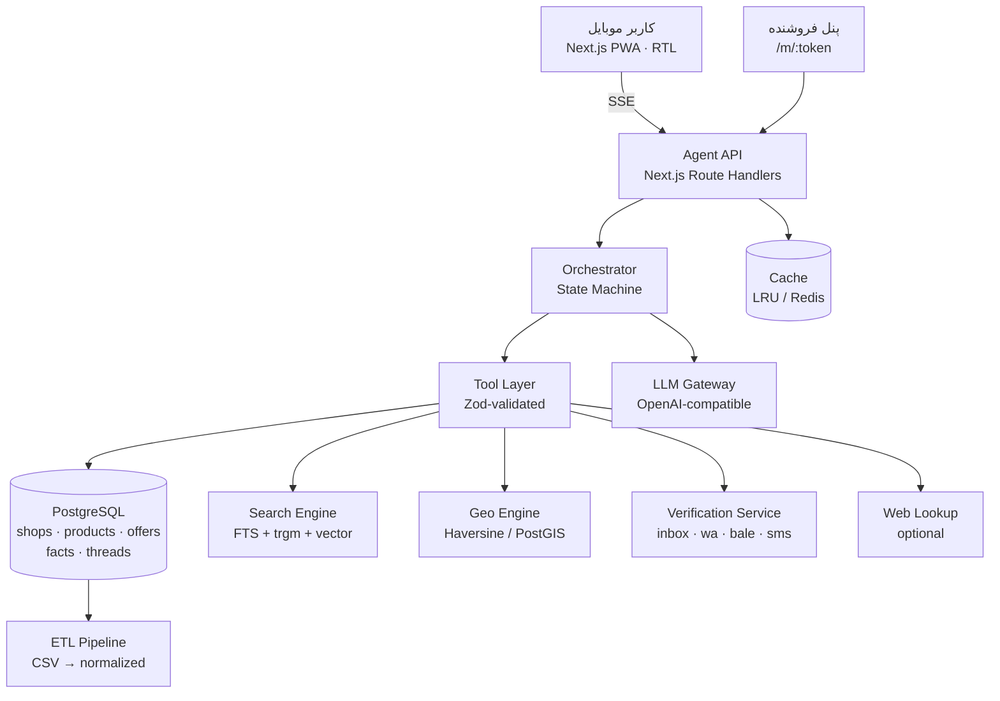

# معماری پیشنهادی — «ترب‌گرد»

> نام کاری: **ترب‌گرد** (قابل تغییر). یک دستیار ایجنتیک برای خرید حضوری در تهران.
> این سند معماری محصول و فنی را برای تأیید شما ارائه می‌کند؛ قبل از کدنویسی نهایی، سه تصمیمِ علامت‌خورده نیاز به تأیید دارد.

---

## ۱. ایده‌ی مرکزی محصول

سه محصول رقیب بالقوه وجود دارد و باید از هر سه فاصله بگیریم:

| الگوی رایج | مشکل | جایگاه ما |
|---|---|---|
| چت‌بات که همه‌چیز را می‌پرسد | کاربر خسته می‌شود؛ خروجی قابل اسکن نیست | **چت + کارت + فیلتر** |
| فروشگاه‌یاب ساده (نقشه) | قیمت و موجودی نامعلوم؛ انتخاب بی‌دلیل | **رتبه‌بندی بر اساس «ارزش رفتن»** |
| مقایسه‌گر آنلاین | خرید حضوری و شرایط مراجعه را نمی‌فهمد | **تأیید فروشنده + برنامه‌ی سفر** |

شعار محصول: **«قبل از اینکه راه بیفتی، مطمئن شو.»**

### سه ستون تمایز

1. **تأیید قبل از حرکت** — قیمت و موجودی از فروشنده پرسیده می‌شود، نه از داده‌ی یک‌هفته‌ای.
2. **تصمیم قابل توضیح** — هر پیشنهاد یک پنل «چرا این؟» با وزن‌های قابل تنظیم دارد.
3. **همراهی تا در مغازه** — آدرس داخل پاساژ، جمله‌ی پرسیدن از نگهبان، مسیر، کارت آفلاین، و جایگزین فوری.

---

## ۲. اصول UX

1. **چت آخرین راه است، نه اولی.** هر چیزی که می‌شود با کارت/چیپ/فیلتر انجام داد، از چت خارج می‌شود.
2. **حداکثر سه پرسش در کشف نیاز.** هر پرسش با گزینه‌های آماده؛ امکان «رد کردن».
3. **همیشه یک قدم بعدی مشخص.** هر صفحه یک CTA اصلی دارد.
4. **شفافیت رنگی.** چهار سطح حقیقت (ثبت‌شده / استنتاج / تأیید فروشنده / تأیید کاربر) رنگ و آیکون ثابت دارند و هیچ‌وقت با هم ترکیب نمی‌شوند.
5. **موبایل اول، فارسی اول.** فونت وزیرمتن self-host، اعداد فارسی در متن و لاتین در قیمت‌های بزرگ، لمس‌پذیر (≥44px).
6. **خطا = پیشنهاد جایگزین.** هیچ پیام بن‌بست («نتیجه‌ای یافت نشد») بدون دکمه‌ی گشادکردن فیلتر.

---

## ۳. پنج صحنه‌ی کلیدی (اسکلت دمو)

### صحنه ۱ — کشف: «چه کتونی‌ای بخرم؟»

- ورودی: «کتونی برای پیاده‌روی روزانه، زیر ۳ میلیون، سایز ۴۲»
- دستیار حداکثر ۳ چیپ می‌پرسد: کاربرد (پیاده‌روی/باشگاه/روزمره)، برند مهم است؟، سقف بودجه.
- خروجی: **۳ کارت محصول** با تصویر، بازه‌ی قیمت بازار (میانه/کمینه)، تعداد فروشنده، و برچسب «مناسب پیاده‌روی».
- دکمه‌ها: «مقایسه» و «فروشنده‌ها».

### صحنه ۲ — مقایسه‌ی محصول

- جدول ۲-۳ ستونه با تفاوت‌های مهم (وزن، جنس، زیره، گارانتی).
- نوار قیمت بازار با نقطه‌ی قیمت هر مدل.
- «چرا این مدل برای تو؟» با ۳ دلیل کوتاه و قابل استناد به دیتاست.

### صحنه ۳ — فروشنده‌ها

- تب «نزدیک من» / «ارزان‌ترین» / «مطمئن‌ترین».
- فیلترهای همیشه‌در دسترس: شعاع، **اقساط**، «الان باز»، «تأییدشده».
- هر کارت فروشنده: نام، محله، فاصله (دقیقه پیاده/ماشین)، قیمت با عمر داده، وضعیت باز/بسته، برچسب اقساط با منبع، دکمه‌ی «تأیید بگیر».
- نقشه‌ی تعاملی با کلاستر + سینک با لیست.

### صحنه ۴ — تأیید

- انتخاب ۱ تا ۳ فروشنده → «درخواست تأیید» با سه پرسش پیش‌فرض: قیمت فعلی؟ موجود؟ تا کی نگه می‌دارید؟
- صفحه‌ی پیگیری زنده: «ارسال شد → دیده شد → پاسخ داد» با تایمر.
- پاسخ فروشنده در قالب **کارت واقعیت** می‌نشیند: قیمت + موجودی + اعتبار تا + کانال + ساعت.
- اگر تایم‌اوت: «فروشنده پاسخ نداد» + **جایگزین‌های نزدیک** (حداکثر ۳، با فاصله و قیمت).

### صحنه ۵ — اجرای سفر

- مسیر چندمقصدی (اگر چند خرید)، زمان حرکت پیشنهادی بر اساس ساعت کاری.
- کارت مغازه: «پاساژ آلتون، طبقه ۲، واحد ۱۴» یا «واحد ثبت نشده» + جمله‌ی آماده برای پرسیدن از نگهبان + کپی آدرس.
- دکمه‌ی مسیریابی (نشان/گوگل مپ) و **کارت آفلاین** (PWA) برای وقتی اینترنت پاساژ ضعیف است.
- پس از مراجعه: «قیمت همان بود؟ موجود بود؟» → یک تپ، ثبت در L3.

---

## ۴. بک‌لاگ قابلیت‌ها (اولویت‌بندی‌شده)

### P0 — الزام بریف (بدون این‌ها محصول ناقص است)

| قابلیت | امتیاز هدف |
|---|---|
| کشف نیاز + پیشنهاد محصول | محصول |
| مقایسه‌ی محصول و قیمت | محصول |
| فروشگاه‌یابی offer-based + فاصله | محصول |
| مقایسه‌ی فروشگاه (قیمت/فاصله/ساعت) | محصول + دادگان |
| فیلتر اقساط با منبع | محصول |
| حلقه‌ی تأیید فروشنده + جایگزین | هوشمندی |
| آدرس داخل پاساژ + جمله‌ی نگهبان | محصول |
| نشان تازگی قیمت و تفکیک موجودی | دیتاست |
| RTL موبایل + حالت‌های خالی/خطا | UX |
| دیپلوی + seed + health | دیپلوی |

### P1 — تمایز (اگر وقت داشت)

- **مسابقه‌ی تأیید:** ارسال به ۳ فروشنده، اولین پاسخ برنده.
- **امتیاز اطمینان:** ترکیب تازگی داده، پاسخ‌گویی، تأیید کاربر.
- **هوش قیمت:** «۱۲٪ زیر میانه‌ی بازار».
- **برنامه‌ی سفر:** ترتیب بهینه‌ی چند مغازه با ساعت کاری.
- **زمان‌سنج باز بودن:** «ساعت ۱۸:۳۰ باز است؟» نه فقط «الان».
- **پنل فروشنده:** لینک اختصاصی، پاسخ با یک تپ، ثبت قیمت.
- **گزارش جمعی:** «کاربران امروز گفتند موجود است».
- **اشتراک‌گذاری کارت مغازه** در واتساپ/بله.

### P2 — اگر زمان اضافه آمد

- سبد چندکالایی و خرید کامل یک پاساژ.
- رزرو نگه‌داشتن کالا تا ساعت مشخص.
- جست‌وجوی وب برای قیمت‌های عمومی.
- تاریخچه و «قیمت هفته‌ی قبل چقدر بود؟».
- حالت آفلاین کامل با سرویس‌ورکر.

---

## ۵. معماری فنی

### ۵.۱ نمای کلی



### ۵.۲ انتخاب‌های فنی و دلیل

| لایه | انتخاب | دلیل |
|---|---|---|
| فرانت/بک | **Next.js 15 + TypeScript (App Router)** | یک دیپلوی، SSR برای SEO/سرعت، RSC، اکوسیستم |
| UI | **Tailwind + shadcn/ui + Vaul (bottom sheet)** | سرعت ساخت، کنترل کامل RTL |
| انیمیشن | Framer Motion (محدود) | حس اپلیکیشن بدون سنگینی |
| دیتابیس | **PostgreSQL 16** | JSONB برای فیلدهای نامنظم دیتاست |
| جست‌وجو | Postgres FTS (`simple`) + `pg_trgm` + بازرتبه‌بندی | بدون سرویس اضافه؛ برای ۲۲۵k محصول کافی |
| برداری (اختیاری) | ایندکس درون‌حافظه‌ای یا `pgvector` | فقط اگر جست‌وجوی معنایی لازم شد |
| نقشه | MapLibre/Leaflet + تایل نشان یا OSM | نیاز به کلید نشان (سؤال P1) |
| LLM | درگاه سازگار با OpenAI (Vercel AI SDK) | تعویض‌پذیر؛ مناسب ایران |
| ETL | Python (offline) + `psycopg` | پردازش CSV، نرمال‌سازی، امبدینگ |
| تست | Vitest + Playwright | سرعت و پوشش E2E موبایل |
| دیپلوی | Docker روی لیارا + Postgres لیارا | اسپانسر رسمی |

> **چرا مونورپو نه؟** در هکاتون، هزینه‌ی هماهنگی بیلد بیشتر از فایده‌ی جداسازی است. یک اپ با ماژول‌های تمیز کافی است.

### ۵.۳ ساختار پیشنهادی ریپو

```
.
├─ app/                        # مسیرهای Next.js
│  ├─ (chat)/                  # جریان اصلی دستیار
│  ├─ m/[token]/               # پنل فروشنده
│  ├─ api/
│  │  ├─ agent/                # SSE
│  │  ├─ verify/               # ایجاد و پیگیری درخواست
│  │  ├─ webhook/              # پاسخ کانال‌ها
│  │  └─ health/
│  └─ admin/                   # trace و شبیه‌ساز پاسخ
├─ src/
│  ├─ domain/                  # موجودیت‌ها، قواعد، رتبه‌بندی
│  ├─ server/                  # ریپازیتوری‌ها، سرویس‌ها، جست‌وجو
│  ├─ agent/                   # state machine، ابزارها، پرامپت‌ها
│  ├─ components/              # UI
│  └─ lib/                     # نرمال‌سازی فارسی، زمان، geo
├─ etl/                        # اسکریپت‌های Python
├─ data/                       # CSV (git-ignored)
├─ docs/
└─ tests/
```

### ۵.۴ مدل داده

```sql
-- هویت و مکان
shops (
  id text pk,
  name text, name_is_placeholder bool,
  business_type text, category text, description text,
  images jsonb, address text, short_address text,
  lat double precision, lng double precision,
  district text, mall_name text, floor text, unit text,
  hours jsonb,            -- {sat:[["10:00","21:00"]], ...}
  phones jsonb, socials jsonb,   -- instagram / website / bale / whatsapp
  torob_presence jsonb,
  installment jsonb,      -- {available:bool, providers:[], source:'declared'|'verified'}
  kalabarg bool, fast_delivery bool, pickup bool,
  contact_publishable jsonb,
  raw jsonb
)

-- کاتالوگ
products (
  id text pk, title_fa text, title_en text, brand text,
  category_path text[], specs jsonb, description text, images jsonb,
  embedding vector(768)  -- اختیاری
)

-- آفر
offers (
  id bigserial pk, shop_id text, product_id text,
  title text, price bigint, price_unit text,
  warranty jsonb, last_price_change timestamptz,
  raw jsonb
)

-- مشتقات
price_stats (product_id pk, min bigint, p25 bigint, median bigint, p75 bigint, max bigint, shop_count int)

-- لایه‌ی تأیید
verification_threads (
  id uuid pk, shop_id text, product_id text,
  status text,            -- draft|sent|seen|answered|timeout|declined
  channel text, expires_at timestamptz, created_at timestamptz
)
verification_messages (id uuid pk, thread_id uuid, direction text, body text, parsed jsonb, created_at timestamptz)
verification_facts (
  shop_id text, product_id text,
  price bigint, in_stock bool, hold_until timestamptz,
  warranty text, channel text, confidence real,
  observed_at timestamptz, expires_at timestamptz,
  primary key (shop_id, product_id, observed_at)
)

-- جلسه و رویداد
sessions (id uuid pk, constraints jsonb, prefs jsonb, created_at timestamptz)
agent_runs (id uuid pk, session_id uuid, state text, tool_calls jsonb, tokens int, latency_ms int, created_at timestamptz)
events (id bigserial pk, session_id uuid, name text, payload jsonb, created_at timestamptz)
```

نکته: فیلدهای `raw` برای حفظ داده‌ی اصلی و امکان بازسازی مشتقات بدون ETL مجدد.

### ۵.۵ خط لوله‌ی داده (ETL)

```
CSV → validate → normalize → derive → load → index → verify
```

1. **Validate:** وجود ستون‌ها، تطابق شناسه‌ها، مختصات در محدوده‌ی تهران (۳۵٫۵–۳۵٫۹ / ۵۱٫۱–۵۱٫۶)، قیمت غیرمنفی، تاریخ معتبر.
2. **Normalize:** ي→ی، ك→ک، حذف اعراب و ZWNJ اضافی، ارقام عربی→لاتین، یکسان‌سازی فاصله، نرمال‌سازی شماره تلفن.
3. **Derive:**
   - `price_stats` برای هر محصول
   - استخراج `mall_name` / `floor` / `unit` از آدرس با regex
   - `district` از نزدیک‌ترین مرکز محله یا ژئوکد یک‌باره
   - `hours` از متن به JSON ساختاریافته
   - `data_age_days` برای هر آفر
4. **Load:** upsert idempotent با کلیدهای طبیعی.
5. **Index:** GIN روی tsvector، trigram روی عنوان/نام، btree روی `(lat,lng)`، ایندکس مرکب `(product_id, price)`.
6. **Verify:** کوئری‌های دودی (smoke) و شمارش رکوردها در `etl_report.json`.

### ۵.۶ جست‌وجو و رتبه‌بندی

**نرمال‌سازی فارسی** ستون فقرات است:

- یکسان‌سازی ی/ک، حذف نیم‌فاصله‌های نامعتبر، ارقام، اعراب
- دیکشنری مترادف: «کتونی = کفش ورزشی = اسنیکرز»، «یخچال = سردکن»، «لپ‌تاپ = نوت‌بوک»
- تشخیص برند از `products.brand` (دیکشنری خودساخته)
- استخراج بودجه: «زیر ۳ میلیون»، «حدود دو تومن»، «تا ۵۰۰ هزار»

**بازیابی:**

1. FTS با پیکربندی `simple` (چون استمر فارسی پیش‌فرض نداریم) + `ts_rank`
2. شباهت `pg_trgm` برای غلط املایی
3. (اختیاری) شباهت برداری برای «پیاده‌روی روزانه» → کتونی رانینگ
4. ترکیب با RRF و حذف تکراری‌ها

**رتبه‌بندی فروشنده (قابل تنظیم):**

```
score = ۰٫۳۵ × برازش قیمت (نسبت به بودجه و میانه)
      + ۰٫۲۵ × نزدیکی زمانی سفر
      + ۰٫۱۵ × تازگی داده
      + ۰٫۱۰ × تأیید موجودی
      + ۰٫۰۵ × باز بودن در زمان مراجعه
      + ۰٫۰۵ × تطابق اقساط/کالابرگ
      + ۰٫۰۵ × اطمینان هویت
```

وزن‌ها از `prefs` کاربر می‌آیند و در UI با اسلایدر/چیپ تغییر می‌کنند. توضیح «چرا این؟» از همین مؤلفه‌ها ساخته می‌شود (قالب + اعداد واقعی)، نه از تخیل LLM.

### ۵.۷ ایجنت

**الگو: State Machine + Tool Calling، نه چت آزاد.**

```
INTAKE → EXPLORE → SHORTLIST → PRODUCT_DECIDED
      → STORE_SEARCH → STORE_COMPARE → VERIFY → PLAN_VISIT → ARRIVED → FEEDBACK
```

هر state دارای: ابزارهای مجاز، شرط خروج، کامپوننت UI، و مسیر fallback.

**ابزارها (همه با Zod schema):**

| ابزار | ورودی | خروجی |
|---|---|---|
| `set_constraints` | patch | constraints به‌روز |
| `search_products` | query, filters, sort | محصولات + آمار قیمت |
| `compare_products` | ids | تفاوت‌های کلیدی |
| `find_stores` | product_id, geo, radius, filters | آفرها + فروشگاه‌ها + امتیاز |
| `get_store` | id | جزئیات، ساعت، آدرس پارس‌شده |
| `check_open` | shop_id, at | باز/بسته + next opening |
| `request_verification` | shop_id, product_id, questions | thread |
| `verification_status` | thread_id | وضعیت + facts |
| `find_alternatives` | product_id, near, exclude | ۳ جایگزین |
| `plan_visit` | shop_ids, origin, at | ترتیب + زمان‌ها |
| `parse_address` | text | mall/floor/unit + جمله‌ی پرسش |

**قواعد سخت:**

1. LLM هیچ عددی تولید نمی‌کند؛ اعداد از tool می‌آیند و در UI bind می‌شوند.
2. اگر tool خالی برگرداند، مدل باید «پیدا نشد» بگوید و گشادکردن فیلتر پیشنهاد دهد.
3. پاسخ فروشنده **داده‌ی غیرقابل‌اعتماد** است: قبل از ورود به پرامپت، به فیلدهای تایپ‌شده تبدیل و از HTML/لینک پاک می‌شود.
4. حداکثر ۳ پرسش متوالی؛ بعد از آن باید نتیجه نشان دهد.
5. هر پاسخ حداکثر ۱ پاراگراف + کارت؛ متن‌های بلند ممنوع.

**مسیریابی مدل:** مدل کوچک برای استخراج نیت و پارس پاسخ فروشنده، مدل بزرگ‌تر برای توضیح و جمع‌بندی. دما پایین، خروجی JSON.

**حالت خرابی:** اگر LLM در دسترس نباشد، ویزارد قاعده‌محور (دسته → بودجه → محله) و جست‌وجوی متنی ساده کار می‌کند. این هم برای پایداری دمو لازم است و هم امتیاز فنی می‌گیرد.

### ۵.۸ حلقه‌ی تأیید (قلب هوشمندی)

**واقعیت:** شماره‌ی تمام فروشگاه‌ها جعلی است. پس تماس واقعی ممکن نیست.

**راه‌حل محصولی (و صادقانه):** یک **صندوق فروشنده** سبک.

```
کاربر: درخواست تأیید → لینک اختصاصی /m/:token
فروشنده: باز می‌کند، سه سؤال را با سه تپ جواب می‌دهد
سیستم: پاسخ را پارس و به Fact تبدیل می‌کند
کاربر: کارت «تأییدشده امروز ۱۴:۰۲»
```

کانال‌های پشتیبانی‌شده (به ترتیب اولویت):

| کانال | وضعیت در دمو | توضیح |
|---|---|---|
| **صندوق فروشنده** | کامل و واقعی | تنها کانال end-to-end با شماره‌های جعلی |
| واتساپ (لینک `wa.me`) | نیمه‌واقعی | کاربر واقعی می‌تواند بفرستد؛ پاسخ خودکار نیست |
| بله | نیمه‌واقعی | نیاز به ربات/توکن (سؤال P1) |
| تماس تلفنی | اسکریپت | شماره جعلی است؛ فقط نمایش اسکریپت |
| جست‌وجوی وب | اختیاری | برای ۱۱۲ فروشگاه با سایت/اینستاگرام واقعی |

**ماشین حالت تأیید:**

```
draft → sent → seen → answered
             ↘ timeout (بعد از ۱۵ دقیقه)
             ↘ declined
```

**مسابقه‌ی تأیید (P1):** درخواست به ۳ فروشگاه‌ برتر؛ اولین پاسخ معتبر برنده؛ بقیه «لغو شد». این صحنه در دمو بسیار تأثیرگذار است.

**Seeding دمو:** برای ۱۵-۲۰ فروشگاه، پاسخ‌های آماده با تأخیر طبیعی ۲۰-۹۰ ثانیه. بقیه timeout می‌شوند تا مسیر جایگزین نمایش داده شود. یک صفحه‌ی `/admin/simulator` امکان پاسخ زنده در هنگام ضبط ویدئو را می‌دهد.

### ۵.۹ پاساژ و آدرس

- استخراج با regex از آدرس: `پاساژ|مجتمع|مرکز خرید|مال|بازار` + نام؛ `طبقه|همکف|زیرزمین` + شماره؛ `واحد|پلاک|مغازه` + شماره.
- کلاسترینگ: نام نرمال‌شده + شعاع ۱۵۰ متر → موجودیت `mall` با تعداد مغازه و دسته‌های موجود.
- نمایش: «پاساژ آلتون، طبقه ۲، واحد ۱۴» و اگر ناقص بود: «واحد ثبت نشده» + جمله‌ی آماده:
  > «سلام، مغازه‌ای که کتونی می‌فروشد در این پاساژ کجاست؟»
- مسیریابی با deep link به نشان/گوگل مپ روی مختصات.
- **صادق باشیم:** نقشه‌ی داخلی پاساژ نداریم؛ ادعای نکنیم.

### ۵.۱۰ هوش قیمت

- `price_stats` در ETL ساخته می‌شود.
- در UI: «۱۲٪ زیر میانه‌ی بازار» / «گران‌تر از ۷۰٪ فروشنده‌ها».
- نوار توزیع قیمت با نقطه‌ی این فروشگاه.
- هشدار: «قیمت این فروشگاه ۹ روز تغییر نکرده؛ ممکن است قدیمی باشد».

---

## ۶. دیپلوی

### ۶.۱ معماری استقرار

```
GitHub Actions ──build/test──> Docker image ──push──> Liara Docker
                                                   ├─ Next.js app
                                                   └─ Postgres (Liara)
```

- `Dockerfile` چندمرحله‌ای با `output: standalone`
- `GET /api/health` → بررسی DB، تعداد رکوردها، وضعیت LLM
- seed idempotent در اولین بوت یا job جدا
- متغیرهای محیطی در لیارا (نه در ریپو)

### ۶.۲ محدودیت مهم محیط توسعه

این محیط توسعه فقط به `github.com`، `npmjs.org` و `pypi.org` دسترسی دارد. بنابراین:

- **هاست آروان (دیتاست) از اینجا قابل دانلود نیست** → باید فایل را مستقیم در چت بدهید یا در ریپو/سرویس دیگری بگذارید.
- **دیپلوی روی لیارا از اینجا ممکن نیست** → دو راه: GitHub Actions با توکن لیارا، یا اجرای دستورات توسط خودتان.
- **فراخوانی LLM از اینجا ممکن نیست** → در توسعه با `LLM_PROVIDER=mock` کار می‌کنیم؛ نسخه‌ی نهایی روی لیارا با کلید واقعی.

### ۶.۳ چک‌لیست دیپلوی (برای امتیاز ۴۰)

- [ ] URL عمومی HTTPS و باز
- [ ] دیتابیس seed شده و پایدار
- [ ] healthcheck سبز
- [ ] تصاویر/فونت/نقشه از داخل ایران قابل بارگذاری
- [ ] LLM از سرور ایران پاسخ می‌دهد (درگاه)
- [ ] fallback بدون LLM
- [ ] لاگ ساختاریافته + trace
- [ ] ری‌استارت بدون از دست رفتن داده
- [ ] صفحه‌ی ۴۰۴ و خطای فارسی

---

## ۷. کیفیت و ارزیابی

### ۷.۱ تست

| نوع | ابزار | پوشش |
|---|---|---|
| واحد | Vitest | نرمال‌سازی فارسی، پارس ساعت، پارس آدرس، امتیازدهی |
| یکپارچه | Vitest + DB تست | جست‌وجو، فیلترها، تأیید |
| E2E | Playwright (viewport موبایل) | پنج صحنه‌ی اصلی + حالت خطا |
| داده | اسکریپت ETL | صحت شمارش، محدوده‌ی geo، قیمت‌های صفر/منفی |

### ۷.۲ هارنس ارزیابی ایجنت

۴۰ پرسش فارسی با پاسخ انتظاری:

- «کتونی زیر ۳ میلیون سایز ۴۲» → باید فیلتر بودجه و سایز را استخراج کند
- «لپ‌تاپ برای برنامه‌نویسی تا ۵۰ میلیون قسطی» → باید فیلتر اقساط را فعال کند
- «مغازه‌ای که یخچال ساید بای ساید دارد نزدیک ونک» → باید offer-based جست‌وجو کند

معیارها: دقت محدودیت‌ها، recall@5، نرخ عدد نامعتبر (باید صفر باشد)، latency p95، پایبندی توضیح به داده.

### ۷.۳ مشاهده‌پذیری

- `agent_runs` برای هر مکالمه: state، tool calls، توکن، زمان
- صفحه‌ی `/admin/runs/:id` برای نمایش trace (هم برای دیباگ، هم نمایش در دمو)
- رویدادهای محصول: شروع، انتخاب، درخواست تأیید، پاسخ، مسیریابی

---

## ۸. نقشه‌ی راه (۸ روز کاری)

| فاز | مدت | خروجی | قابل نمایش؟ |
|---|---|---|---|
| ۰ | نیم روز | پروفایل دیتاست، اسکیمای نهایی، ۲۰ کوئری طلایی | گزارش |
| ۱ | ۱٫۵ روز | ETL + دیتابیس + API جست‌وجو و فروشگاه | API |
| ۲ | ۱٫۵ روز | UI موبایل: کشف، مقایسه، لیست/نقشه | دموی نیمه‌کامل |
| ۳ | ۱٫۵ روز | ایجنت + تأیید + جایگزین + پاساژ | دموی کامل |
| ۴ | ۱ روز | پالایش UX، حالت‌های خالی، PWA | دموی نهایی |
| ۵ | ۱ روز | دیپلوی، seed، تست، eval | لینک زنده |
| ۶ | ۱ روز | ویدئو، متن، ارائه | تحویل |

> اگر زمان کمتر است، P0 را حفظ و P1 را قربانی می‌کنیم؛ اما حلقه‌ی تأیید و جایگزین هرگز حذف نمی‌شود چون ۵۰ امتیاز هوشمندی به آن وابسته است.

---

## ۹. اسکریپت ویدئوی ۵ دقیقه‌ای

| زمان | صحنه | جمله‌ی کلیدی |
|---|---|---|
| ۰:۰۰–۰:۳۰ | مسئله | «قیمت ترب یک هفته قدیمی است؛ موجودی معلوم نیست» |
| ۰:۳۰–۱:۲۰ | کشف + مقایسه | «نمی‌دانم چه کتونی؛ دستیار در ۳۰ ثانیه به ۳ گزینه رساند» |
| ۱:۲۰–۲:۲۰ | فروشنده + فیلتر اقساط | «فقط مغازه‌هایی که اقساط دارند و الان بازند» |
| ۲:۲۰–۳:۲۰ | تأیید + پاسخ فروشنده | «قیمت امروز، تأییدشده در ۴۰ ثانیه» |
| ۳:۲۰–۴:۱۰ | تایم‌اوت + جایگزین + پاساژ | «فروشنده جواب نداد؛ جایگزین ۳۰۰ متر آن‌طرف‌تر» |
| ۴:۱۰–۴:۴۰ | سفر + کارت آفلاین | «طبقه ۲ واحد ۱۴؛ حتی بدون اینترنت» |
| ۴:۴۰–۵:۰۰ | دیپلوی + بستن | «لینک زنده، معماری، و درس‌ها» |

نکته: ویدئوی دمو **الزامی** است؛ نبودش حذف از داوری را در پی دارد.

---

## ۱۰. سه تصمیم نیازمند تأیید شما

1. **کانال تأیید:** آیا با مدل «صندوق فروشنده + پاسخ شبیه‌سازی‌شده» موافقید؟ (تنها راه واقعی با شماره‌های جعلی)
2. **پشته:** Next.js + Postgres روی لیارا تأیید است؟ اگر تیم شما Python/React ترجیح می‌دهد، الان تغییر دهیم.
3. **نقشه:** کلید نشان/مپ.آی‌آر دارید یا OSM کافی است؟
